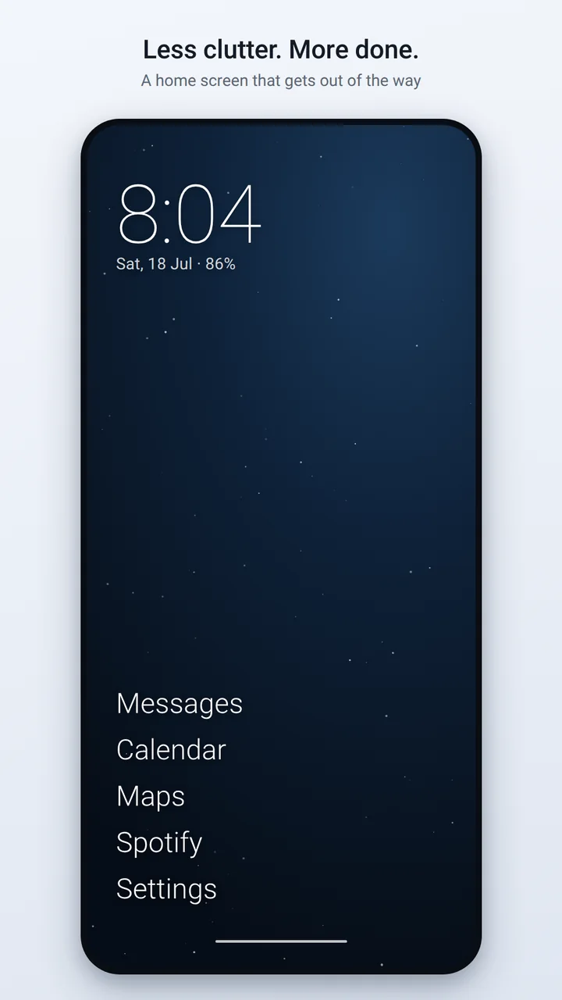
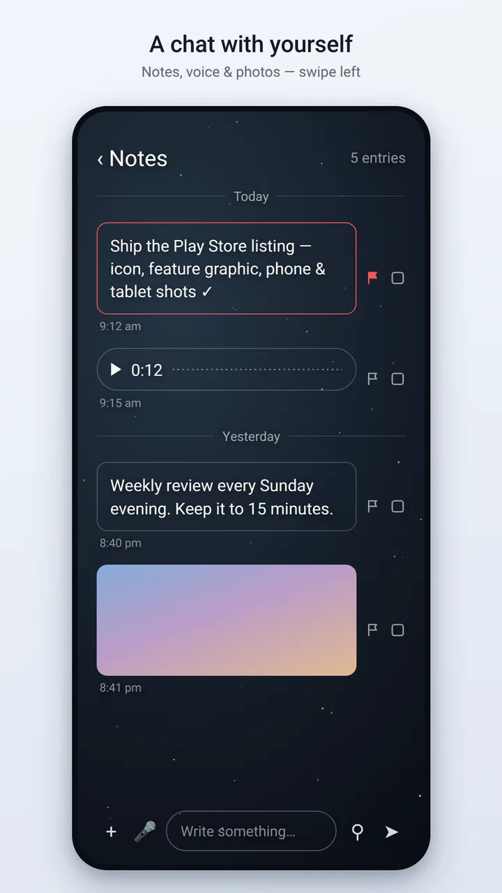
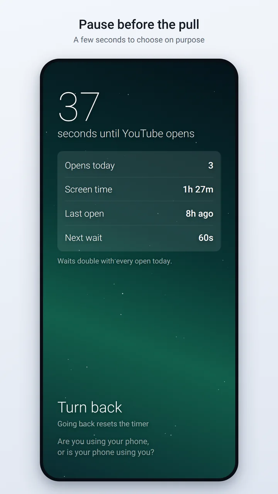
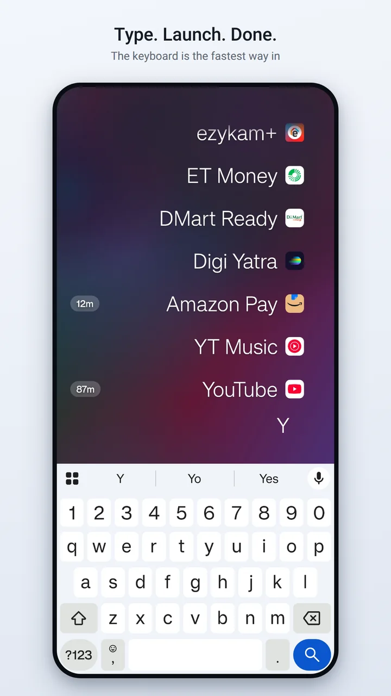

# Launch0 — OS for the busy

**Launch0 is an OS for the busy: a free, open-source minimalist launcher for Android with built-in notes, to-dos, a distraction timer, held notifications and screen time.** No ads, no tracking, no internet permission.

[Website](https://launch0.app) · [Features](https://launch0.app/guide/features) · [Download](https://launch0.app/download) · [Privacy](https://launch0.app/privacy)

  
  
  
  

## Why Launch0

Your phone's home screen is built to pull you in. Launch0 turns it into one calm surface — launcher, notepad, focus tool and time tracker in one — so each unlock moves your day forward.

## Features

- **Text-only home screen**: up to 8 apps as plain text, with date, time and battery
- **Instant search**: type and the top match launches; A–Z fast-scroll; optional icons
- **[Notes and to-dos](https://launch0.app/features/notes)**: text, voice memos and images, one swipe left from home
- **[Distraction timer](https://launch0.app/features/distraction-timer)**: a 10–60 second wait before apps you flag as distracting
- **[Hold notifications](https://launch0.app/features/hold-notifications)**: park notifications from chosen apps for 30 minutes to 3 hours (Android 8.0+)
- **[Calendar widget](https://launch0.app/features/calendar-widget)**: today's remaining events on the home screen
- **Screen time**: today's usage beside each app
- **Wallpapers made on your device**, a new one every hour
- **Work profile and dual apps**, dark and light themes, 20 languages

## Install

- **Google Play** (recommended, updates automatically): [app.launch0](https://play.google.com/store/apps/details?id=app.launch0)
- **APK**: [latest release](https://github.com/ketansp/launch0/releases/latest). Play and GitHub builds are signed with different keys, so switching between them means uninstalling, which deletes your notes.
- **Build from source**: see [the guide](https://launch0.app/guide/build).

Requires Android 7.0 or later.

## Privacy

Launch0 declares no `INTERNET` permission, so it cannot send data anywhere. No account, no analytics, no ads. Every permission and what it's for: [launch0.app/privacy](https://launch0.app/privacy).

## Launch0 vs Olauncher

Launch0 is a fork of [Olauncher](https://github.com/tanujnotes/Olauncher) by [tanujnotes](https://github.com/tanujnotes) and keeps its text-only home screen. It adds Notes and to-dos, a distraction timer, held notifications, a calendar widget and on-device wallpapers, and it works without the internet permission. Full comparison: [Launch0 vs Olauncher](https://launch0.app/compare/olauncher).

## Contributing

Issues and pull requests are welcome. See [Contributing](https://launch0.app/guide/contributing).

## License and credits

[GPLv3](LICENSE). Launch0 builds on Olauncher by tanujnotes; all credit for the original design and implementation goes to the Olauncher team.
